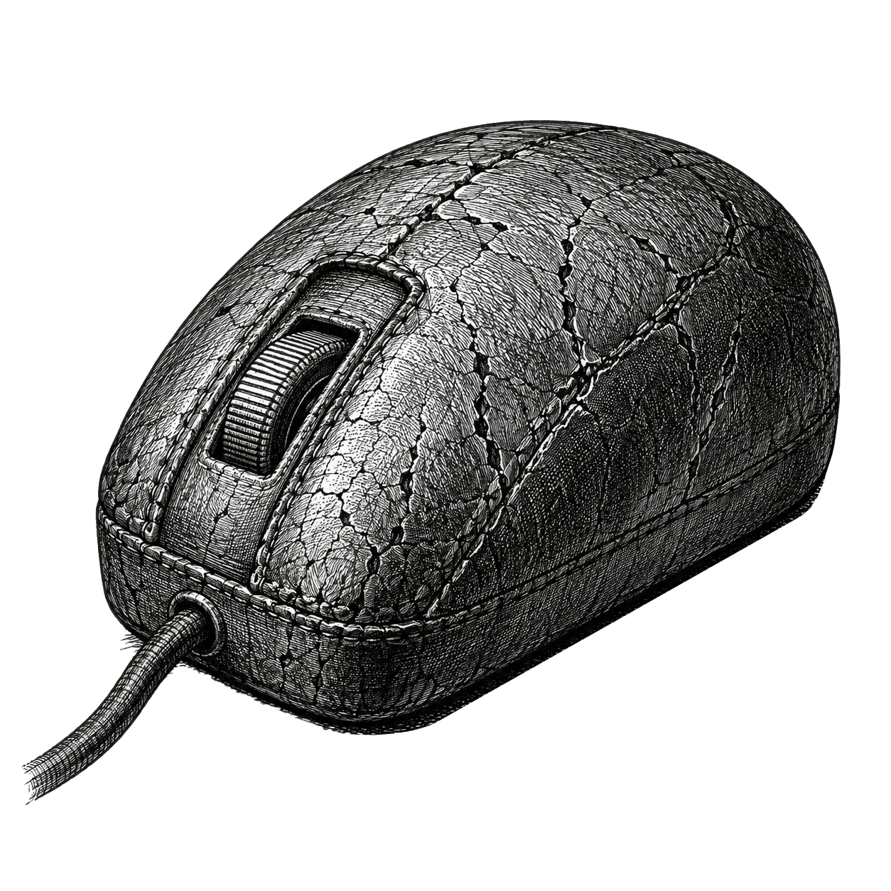

# sprezzature-accessibility

[](LICENSE)
[](https://www.python.org/)

🇫🇷 LISEZMOI.md · [🇬🇧 README.md](README.md)

[](https://sprezzature.ai/)

Une page web est accessible quand une personne qui utilise un lecteur d'écran, qui
navigue au clavier seul (sans souris), ou qui a activé le réglage « mouvement réduit »
de son navigateur, peut malgré tout s'en servir. Cet outil relit le code source HTML
à la recherche des erreurs qui cassent le plus souvent cette expérience : une balise
`` sans texte alternatif est aussi invisible pour un lecteur d'écran que si
l'image n'existait tout simplement pas sur la page.

C'est un linter statique : vingt règles issues des WCAG (*Web Content
Accessibility Guidelines*, la norme du W3C qui définit ce que « accessible » veut
dire pour le web) et de WAI-ARIA (le vocabulaire d'attributs, `role`, `aria-label`
et consorts, qui permet à un composant fait maison de se décrire aux logiciels
d'assistance), chacune décidable à la seule lecture du texte HTML. Aucun navigateur
ne s'ouvre, aucune page ne s'affiche, aucun JavaScript ne s'exécute : il n'y a donc
pas de DOM (l'arbre d'éléments qu'un navigateur construit en affichant une page) à
inspecter, et rien à installer en dehors de Python lui-même. C'est ce qui rend
l'outil assez rapide pour un hook pre-commit ou une étape d'intégration continue
(CI) : une porte déterministe avant que la moindre modification n'atteigne la
production.

Les violations couvertes représentent la majorité des problèmes d'accessibilité
réels : textes alternatifs manquants, champs de formulaire sans étiquette, boutons
vides, `<div>` cliquables qu'un clavier ne peut pas atteindre, fenêtres de dialogue
sans moyen de les fermer au clavier, attribut `lang` absent (ce qui casse la
prononciation du lecteur d'écran), niveaux de titre qui sautent au lieu de s'emboîter
dans l'ordre, état montré par la seule couleur (un rouge et un vert qu'une personne
daltonienne ne distingue pas), et animations sans moyen de les réduire pour qui y est
sensible, et un espacement des lettres resserré sur du texte de lecture (ce qui
ralentit la lecture des personnes dyslexiques). Six de ces vingt règles disposent
en plus d'une correction automatique mécanique (`--fix`), pour que la porte répare
elle-même ce qu'elle peut réparer sans risque, au lieu de se contenter de le
signaler.

Cet outil ne lit que du code source : il ne peut donc pas détecter ce qui n'apparaît
qu'une fois la page réellement affichée dans un navigateur, l'ordre de parcours au
clavier, le minutage des annonces du lecteur d'écran, le contraste des couleurs sur
un fond réel. Associez-le à axe-core, Pa11y ou Lighthouse, qui pilotent un vrai
navigateur, pour cette couche-là. Les deux approches se complètent, elles ne se
remplacent pas : celui-ci est la porte rapide sans navigateur ; les autres sont la
passe plus lente mais fidèle au rendu réel.

## Comment ça marche


## Fonctionnalités

- 20 règles couvrant img, a, button, div/span, input, dialog, html, tabindex, aria,
  ordre des titres, état par couleur seule, guards motion-reduce, espacement des
  lettres sur le texte de lecture, et les médias temporels : sous-titres vidéo,
  transcription audio, lecture automatique non muette, commandes au clavier,
  et langue de la piste de sous-titres
- Correction automatique pour 6 règles : détection et insertion du lang, suppression
  d'aria redondant, rétrogradation du tabindex, suppression d'aria-hidden, ajout du
  guard motion-reduce, suppression du resserrement de lettres
- `text_spacing_preset.py` : le pendant « make » de la règle d'espacement des
  lettres — génère un bloc CSS optionnel « lecture confortable » aux minima WCAG
  1.4.12, pour les pages qui veulent proposer la correction comme un réglage
  visible par le lecteur
- Sortie texte et JSON, composable avec jq ou tout parseur CI
- Code de sortie 1 sur tout résultat (0 si propre), utilisable comme porte pre-commit
- Stdlib Python uniquement à l'exécution : Python 3.10+, pas de pip install requis
- `langdetect` optionnel pour le correcteur automatique `html-missing-lang`

## Démarrage rapide

```bash
# Lint d'une page unique
sprezzature-accessibility-lint public/index.html

# Lint récursif d'un répertoire, sortie 1 sur tout résultat
sprezzature-accessibility-lint public/

# Sortie JSON pour une chaîne CI
sprezzature-accessibility-lint --format json public/index.html

# Ignorer deux règles
sprezzature-accessibility-lint --ignore heading-skip,motion-no-reduce-guard public/

# Corriger automatiquement ce qui peut l'être
sprezzature-accessibility-lint --fix public/

# Prévisualiser sans écrire
sprezzature-accessibility-lint --fix --dry-run public/
```

## Deux portes d'entrée, quatre outils

```bash
make-a11y --help              # les quatre outils, et ce que fait chacun
make-a11y lint public/        # argparse — ne demande rien
sprezzature-accessibility lint public/   # click — demande [click]
```

Les deux lisent **une seule** table (`sprezzature_accessibility/cli.py`), donc
un outil ne peut pas apparaître dans l'une et manquer dans l'autre. Les quatre
sont `lint`, `text-spacing`, `alt` et `install-alt` ; chacun reste aussi sa
propre commande — `sprezzature-accessibility-lint`, `-text-spacing`, `-alt` —
et c'est ce qu'un script devrait appeler, comme dans les exemples ci-dessus.

## Installation

```bash
pip install sprezzature-accessibility                # le lint : aucune dépendance
pip install "sprezzature-accessibility[lang]"        # + détection de langue pour --fix
pip install "sprezzature-accessibility[click]"       # + la porte click
pip install "sprezzature-accessibility[alt]"         # + la moitié rédactionnelle (modèle de vision local)
pip install "sprezzature-accessibility[api,mcp]"     # + les surfaces HTTP et agent
```

Que le lint lui-même n'ait **aucune dépendance** est délibéré, et c'est la
raison pour laquelle ce paquet vaut la peine d'être mis dans un crochet de
pré-commit : il tourne en quelques millisecondes dans un conteneur minimal,
sans navigateur ni modèle derrière lui. Tout ce qui est plus lourd est un
extra, nommé d'après ce qui en a besoin, pour qu'une installation dise à quoi
elle sert.

## Les règles

| Règle | Sévérité | Description |
|---|---|---|
| `img-missing-alt` | erreur | `` sans attribut alt |
| `img-redundant-aria` | avertissement | `alt=""` avec un role/aria-hidden redondant |
| `a-missing-href` | erreur | `<a>` sans href (utiliser `<button>`) |
| `a-empty` | erreur | `<a>` sans nom accessible |
| `button-empty` | erreur | `<button>` sans nom accessible |
| `div-onclick` | erreur | div/span avec onclick, sans role ni tabindex |
| `input-missing-label` | erreur | `<input>` sans label associé |
| `dialog-missing-close` | erreur | `<dialog>` sans moyen de fermeture |
| `html-missing-lang` | erreur | `<html>` sans attribut lang |
| `tabindex-positive` | erreur | tabindex ≥ 1 casse l'ordre du DOM |
| `aria-hidden-interactive` | erreur | aria-hidden sur un élément interactif |
| `heading-skip` | erreur | les titres sautent un niveau vers le bas |
| `color-only-state` | avertissement | jeton rouge/vert sans icône ni texte |
| `motion-no-reduce-guard` | avertissement | animation sans pair motion-reduce |
| `body-text-tracking-tight` | avertissement | interlettrage resserré sur du texte de lecture |
| `video-missing-captions` | erreur | `<video>` avec du son et sans `<track kind="captions">` (WCAG 1.2.2) |
| `audio-missing-transcript` | erreur | `<audio>` sans alternative textuelle (WCAG 1.2.1) |
| `track-missing-srclang` | avertissement | `<track>` sans `srclang` : langue des sous-titres inconnue |
| `media-missing-controls` | erreur | `<video>`/`<audio>` sans rien à actionner au clavier (WCAG 2.1.1) |
| `media-autoplay-sound` | erreur | `autoplay` non muet, qui couvre un lecteur d'écran (WCAG 1.4.2) |

Six de ces règles portent aussi un correcteur mécanique, appliqué par `--fix`.

## Licence

BSD-3-Clause. Copyright 2026 Warith HARCHAOUI.
